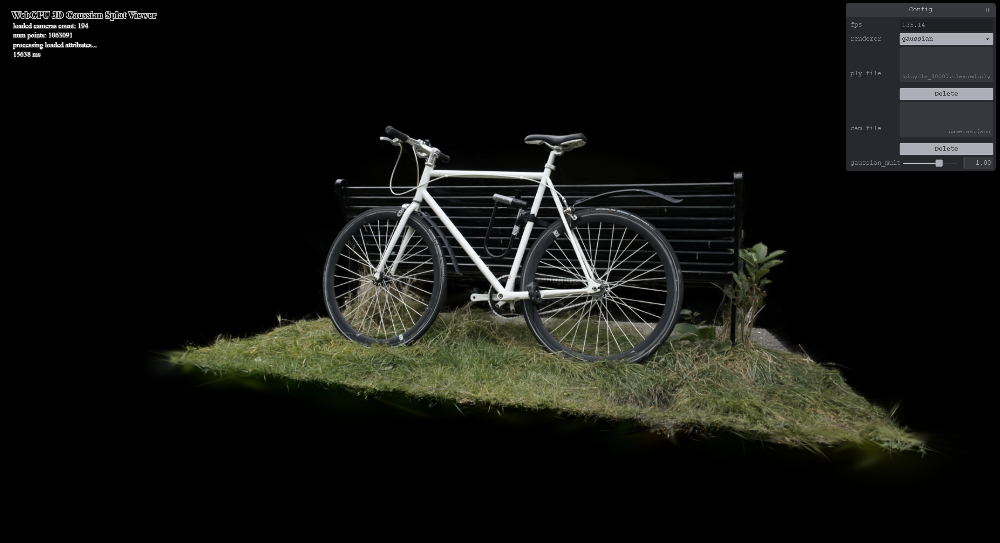
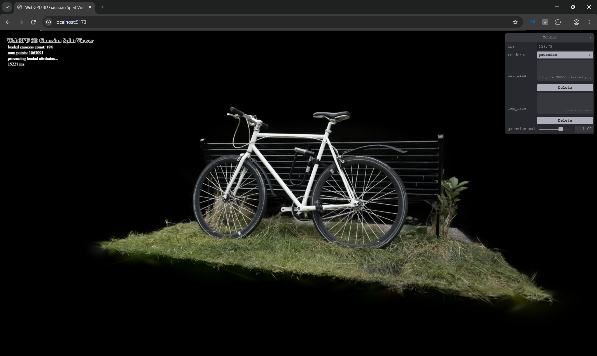
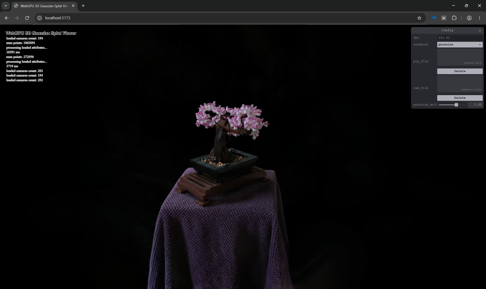
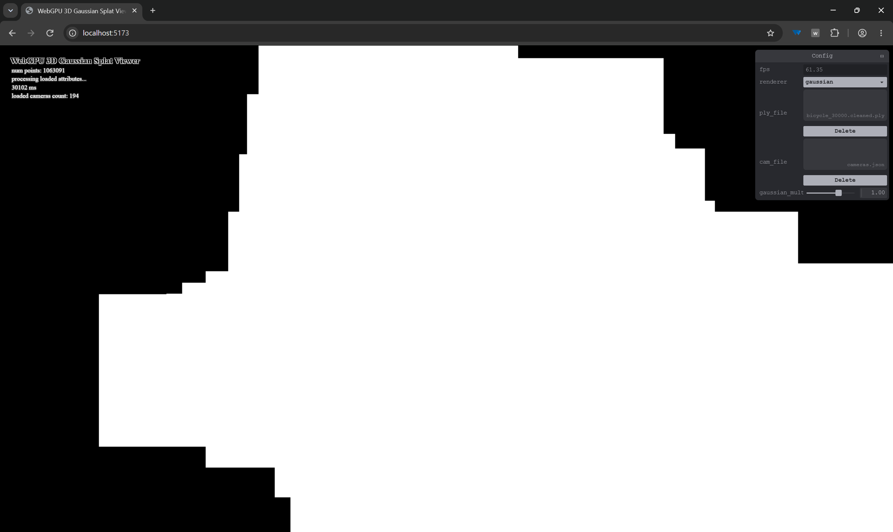
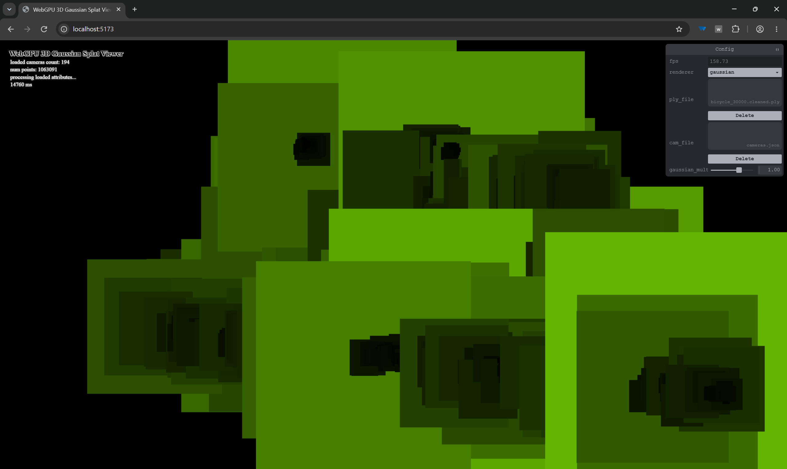
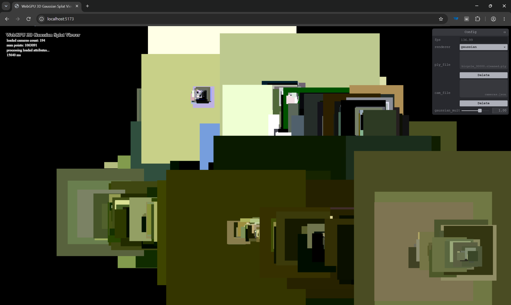
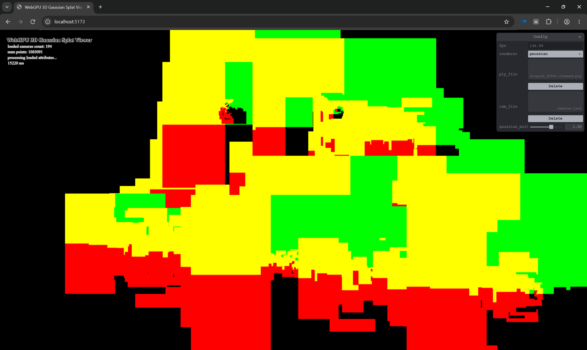
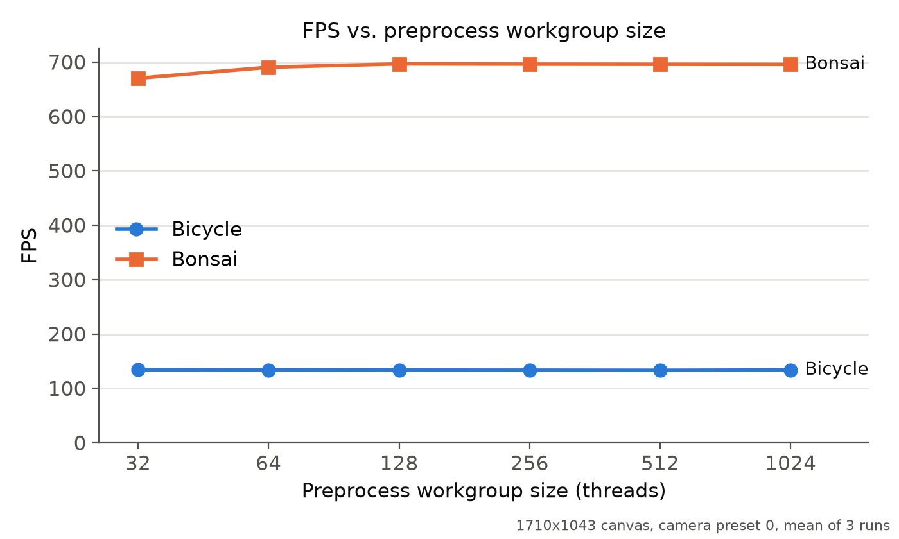

# Project5-WebGPU-Gaussian-Splat-Viewer

**University of Pennsylvania, CIS 565: GPU Programming and Architecture, Project 5**

* Stephen Gavin Sears
  * [LinkedIn](https://www.linkedin.com/in/gavin-sears-536a1b285), [personal website](https://gavinsears.dev)
* Tested on: Windows 11, i9-14900HX @ 2.20GHz 32GB, RTX 4090 Laptop 16GB, Compute Capability 8.9 (Personal Computer)

### Live Demo

This live site will not have the bike and bonsai files included. To download them and try them out yourself, you can use this [Google Drive Folder](https://drive.google.com/drive/folders/1Fz0QhyDU12JTsl2e7umGi5iy_V9drrIW?usp=sharing).

### Demo Video

<!-- Will be drag and dropped after committing this README -->

## Overview

A real-time 3D Gaussian Splatting viewer written in TypeScript and WGSL on WebGPU. It loads pretrained
Gaussian scenes (`.ply`) and camera presets (`cameras.json`), then renders them in the browser.
The GPU-driven pipeline includes a compute pass, which projects each Gaussian to a 2D screen-space splat, a GPU radix sort to order splats by depth, and an indirect instanced draw that blends the quads.

| Bicycle | Bonsai |
|---|---|
|  |  |

## Features Implemented

- **Point cloud renderer:** One point per Gaussian
- **Preprocess compute pass** (one thread per Gaussian):
  - Unpacks Gaussian data
  - Culls Gaussians outside of the view frustum, with some padding.
  - Finds 2D covariance and conic matrix (inverse of the 2D covariance). covariance = Σ = R * S * ST * RT, 2D covariance = JWΣWTJT, where J is the Jacobian of the projection transformation, and W is the rotation part (upper-left 3x3) of the view matrix. We must use the Jacobian (a linear approximation of the projection at the Gaussian's center) as opposed to the actual projection because projection is a non-linear function, so a projected Gaussian would no longer be a Gaussian, which would make it much harder to evaluate.
  - Evaluates view dependent colors using spherical harmonics (view direction is plugged into a fixed set of polynomials, the spherical harmonic basis, weighted by coefficients that we get from the files. We can have color change with direction in a customizable way using this.)
  - Collects splat indices and other info for sorting.
- **GPU-driven rendering:**
  - Quads built around each Gaussian, which are drawn in the sorted order
  - The fragment shader evaluates the Gaussian falloff for opacity using the conic (for each pixel on the quad, calculate offset from the Gaussian's mean in pixel coordinates. Then evaluate exp(-0.5 * offsetT * conic * offset) to find the falloff, where conic is the inverse of the 2D covariance matrix).
- **Runtime settings:** Interactive slider to control Gaussian size.

## Development Milestones

In the instructions for this assignment, I was given some references with instructions on how to get them. I thought I would do a commit for each feature that I achieved, and include a screenshot. You can see my progress side by side with the reference.

| Stage | Mine | Reference |
|---|---|---|
| Quad size from using radius of three std deviations |  |  |
| Depth sort, colored by quad size |  |  |
| Spherical-harmonic color |  |  |
| Pixel offset from splat center |  |  |

## Performance Analysis (Assignment Questions)
### Point cloud vs. Gaussian renderer

As you would probably imagine, the point cloud renderer performs significantly faster than the Gaussian rendering. I used the WebGPU DevTools extension to quickly take a look at the fps while rendering the bike scene (note that I used the cleaned version in my screenshots. Also note that I used Google Chrome, and turned off vsync and framerate limiting), and the point cloud was always somewhere in the range of 1000-3000fps, while the Gaussian version was around 130-150fps. The reason for this is that the point cloud renders something like a pixel for each Gaussian, while the Gaussian rendering is doing some matrix math for every Gaussian, sorting the visible ones, creating a quad (two triangles) for each of them, then evaluating a fragment shader for each pixel on a quad. Overall, the last step is the most expensive, since there is a large number of fragments to draw and layer over each other when rendering the Gaussians. 

While the performance of point cloud is much higher, the two rendering methods have much different purposes visually. The point cloud is, unsurprisingly, very sparse, and does not cover the surface of the objects we are trying to depict. However, this is still useful for visualizing the data in the file for debugging purposes. The Gaussians, on the other hand, create much more seamless looking surfaces (despite also not being any kind of manifold structure), because each point (mean) now gets a covariance, which influences the color of a small area with a falloff. Additionally, you also get the benefit of the spherical harmonics, so some of those colors can change depending on the view direction, providing the ability to depict different types of materials captured in the original scene.

### Workgroup size

The renderer was run in Chrome with vsync and the frame-rate limit off, using camera preset 0 for each scene on a 1710x1043 canvas. Each configuration was measured for 4 seconds after a 1.5 second warmup, and all of the configurations were run in the same order in three rounds of tests. This chart displays the mean of the three runs. This test changed the preprocess compute shader's workgroup size.

It appears that workgroup size did not have any effect on my performance. The only exception to this is the bonsai scene, which was a little slower at a workgroup size of 32. I think the reason for this slight slowdown is because the workgroup size is the same as the warp size, and the limit for the number of active workgroups is lower than the limit for the number of active warps. This means that the larger workgroups will get to have more warps active with pretty much no downside. In addition, we are only seeing this affect the bonsai scene because that scene likely has relatively more preprocessing work compared to fragment shader work, and this test is changing workgroup size for the preprocessing.

### View-frustum culling

View frustum culling provides a performance improvement by ignoring Gaussians that appear outside of the boundaries of the screen (whether that be behind the camera, outside the vertical and horizontal bounds, or past the far plane of the camera). By ignoring these Gaussians, we can reduce the work needed to render the scene, without visibly changing the final output.

In this approach, view frustum culling will not improve the fragment stage of rendering, since anything outside of the screen is already clipped before it reaches that stage. However, we are saving work in parts of the compute shader, during the sorting, and during the vertex stage where we create the quads for each Gaussian.

### Number of Gaussians

The number of Gaussians affects performance, but how much of the screen the Gaussians cover matters a lot as well. 

More Gaussians puts more work on the compute shader, and more visible Gaussians put more work on the sort and the vertex shader. This work scales in a linear fashion, since these operations do calculations for every Gaussian. However, the performance of the fragment shader, which is usually the most expensive part of the pipeline, depends more on the number of pixels covered than the number of Gaussians. You could have many small Gaussians clustered into the same spot, and it would not be as expensive as drawing fewer Gaussians that cover a large part of the screen. I did some tests comparing the performance in the two scenes while removing some percentage of the Gaussians. In a bike scene with a quarter of the number of Gaussians (around 266 thousand), the app achieved around 500 fps. However, the full bonsai scene, with around 270 thousand Gaussians, ran at around 700 fps. This at least shows that scenes with a similar and even slightly lower number of Gaussians can perform worse than a scene with more, and my suggestion would be that it has to do with the amount of screen covered, since the bonsai model does not take up as much screen space.

## Credits

- [Vite](https://vitejs.dev/)
- [tweakpane](https://tweakpane.github.io/docs//v3/monitor-bindings/)
- [stats.js](https://github.com/mrdoob/stats.js)
- [wgpu-matrix](https://github.com/greggman/wgpu-matrix)
- [3D Gaussian Splatting for Real-Time Radiance Field Rendering](https://repo-sam.inria.fr/fungraph/3d-gaussian-splatting/) (Kerbl et al., 2023)
- [Gaussian splatting notes](https://github.com/kwea123/gaussian_splatting_notes) (kwea123), for the covariance, conic and radius derivations
- [Spherical harmonics post](https://beatthezombie.github.io/sh_post_1/)
- Special Thanks to: Shrek Shao (Google WebGPU team) & [Differential Gaussian Rasterizer](https://github.com/graphdeco-inria/diff-gaussian-rasterization)
